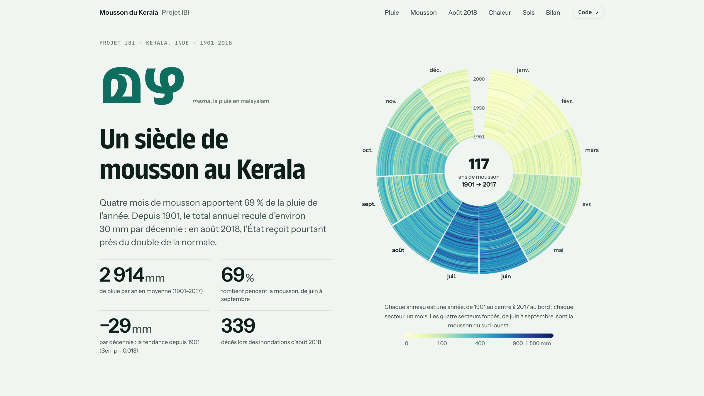
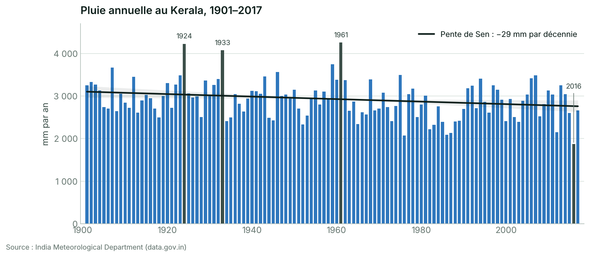
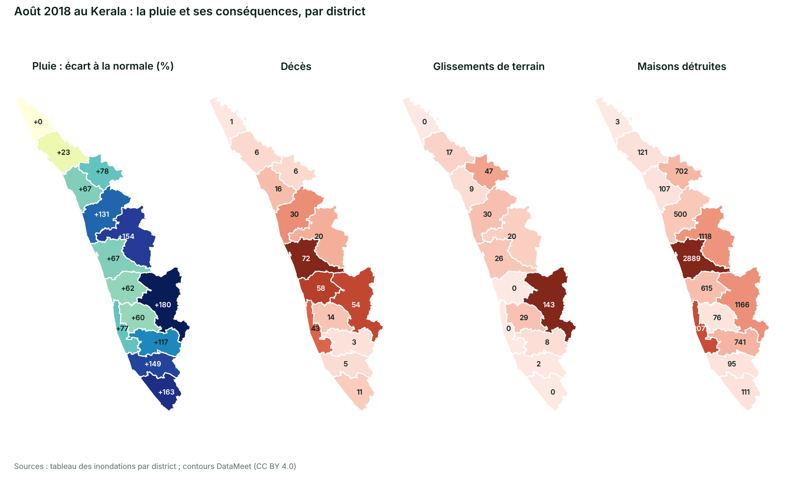
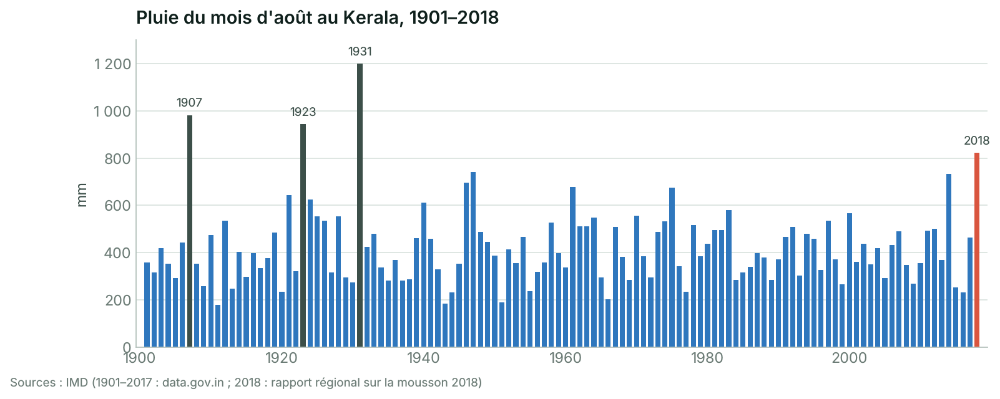

# Précipitations dans le Kerala : un siècle de mousson

De 1901 à 2017, la pluie annuelle du Kerala a baissé d'environ 30 mm par décennie (−11 % en
117 ans), portée par la mousson qui en apporte 69 % ; en août 2018, l'État a pourtant reçu près
du double de la normale.

[](https://youssefmir.github.io/Precipitations-dans-le-Kerala/)

**[Voir le site interactif](https://youssefmir.github.io/Precipitations-dans-le-Kerala/)** · [Lire le notebook](https://github.com/youssefmir/Precipitations-dans-le-Kerala/blob/main/notebooks/kerala_monsoon.ipynb) · [Données](#données)

## En bref

- La mousson du sud-ouest (juin à septembre) apporte **69 %** des 2 914 mm de pluie annuelle
  moyenne.
- La pluie annuelle baisse de **29 mm par décennie** depuis 1901 (pente de Sen, test de
  Mann-Kendall : p = 0,013), soit −11 % en 117 ans ; la baisse vient surtout de la mousson.
- Les moussons déficitaires sont plus fréquentes depuis 1961 (11 sur 14), mais la variabilité
  d'une année à l'autre n'augmente pas de façon significative.
- **Août 2018** : 821,9 mm (+96 %), 4ᵉ mois d'août le plus pluvieux depuis 1901 ; 339 décès et
  10 319 maisons détruites. La pluie explique les glissements de terrain, pas le nombre de décès.
- L'Inde se réchauffe de **1,2 °C par siècle**, en toute saison.

## Le projet

Projet de bio-informatique (IBI) réalisé en 2023 par Ilan Aliouchouche, Marwan Khairallah et
Youssef Mir. La question : comment évoluent les précipitations du Kerala, État du sud-ouest de
l'Inde dont l'agriculture et des millions d'habitants dépendent de la mousson, et que révèlent
les inondations meurtrières d'août 2018 ? Le dépôt contient un site interactif (`docs/`), un
notebook commenté (`notebooks/kerala_monsoon.ipynb`) et un package Python testé
(`src/kerala_rain`).

## Démarrage rapide

Prérequis : Python 3.10 ou plus récent (testé avec Python 3.11).

```bash
git clone https://github.com/youssefmir/Precipitations-dans-le-Kerala.git
cd Precipitations-dans-le-Kerala
python -m venv .venv
source .venv/bin/activate        # Windows : .venv\Scripts\activate
pip install -r requirements.txt
pip install -e .
jupyter notebook notebooks/kerala_monsoon.ipynb
```

Le notebook s'exécute en une dizaine de secondes. Toutes les données sont dans le dépôt : aucune
clé ni aucun téléchargement n'est nécessaire.

## Utilisation

- Régénérer les données du site : `python scripts/build_site_data.py`
- Prévisualiser le site : `python -m http.server -d docs 8000`, puis ouvrir http://localhost:8000
- Lancer les tests : `pip install -r requirements-dev.txt`, puis `pytest`
- Réutiliser le code :

```python
from kerala_rain import data, stats

rain = data.load_rainfall()                     # pluie mensuelle et annuelle, 1901–2017 (mm)
trend = stats.sen_mann_kendall(rain["ANNUAL"])  # pente de Sen et test de Mann-Kendall
print(f"{trend.per_decade:+.1f} mm par décennie, p = {trend.p_value:.3f}")
# -29.5 mm par décennie, p = 0.013
```

## Résultats



La pluie annuelle varie fortement d'une année à l'autre, mais sa tendance descend de façon
significative. Les barres sombres sont des années extrêmes réelles (1924, 1933, 1961, 2016),
conservées dans l'analyse.



En août 2018, tous les districts sauf Kasaragod reçoivent plus que la normale, jusqu'à +180 %
dans l'Idukki. Les glissements de terrain suivent la pluie (corrélation de Spearman ρ = 0,76) ;
les décès, eux, se concentrent dans les plaines peuplées de Thrissur, Ernakulam et Alappuzha
(ρ = 0,20, non significatif).



À l'échelle de l'État, août 2018 n'est pas un record de volume : 1931, 1907 et 1923 ont été
plus pluvieux. C'est la concentration de la pluie, du 14 au 17 août, sur des sols
vraisemblablement saturés par un juin et un juillet excédentaires, qui rend l'épisode
exceptionnel.

## Méthode

1. **Données** : pluies mensuelles de l'India Meteorological Department (IMD), 1901–2017 ; contrôle
   de cohérence (la somme des mois retrouve le total annuel).
2. **Tendances** : pente de Sen (médiane des pentes entre toutes les paires d'années, peu sensible
   aux extrêmes) et test de Mann-Kendall (détecte une tendance monotone sans supposer de loi
   normale). Contrôles : moindres carrés, intervalle de confiance par bootstrap, correction de
   l'autocorrélation (Hamed-Rao) et retrait des années extrêmes.
3. **Variabilité** : test de Brown-Forsythe (compare deux dispersions, robuste à l'asymétrie) et
   coefficient de variation sur des fenêtres de 30 ans.
4. **Saisonnalité** : test de Mann-Whitney (compare deux distributions par les rangs) sur la part
   de chaque mois dans l'année, 1901–1930 contre 1988–2017.
5. **Août 2018** : période du tableau vérifiée par la moyenne des districts pondérée par leur
   surface ; corrélation de rang de Spearman entre pluie et dégâts ; comparaison avec l'histoire
   à partir du chiffre officiel de l'IMD pour l'État.
6. **Températures** : pente de Sen par saison ; tests de Welch et de Mann-Whitney entre 1901–1959
   et 1960–2017.

## Données

| Fichier (`data/raw/`) | Contenu | Source | Licence |
|---|---|---|---|
| `kerala_rainfall_1901_2017.csv` | Pluie mensuelle, saisonnière et annuelle (mm), 1901–2017 | IMD, via [data.gov.in](https://data.gov.in) | Government Open Data License – India |
| `india_temperatures_1901_2017.csv` | Températures de l'Inde entière (°C), 1901–2017 | IMD, via data.gov.in | Government Open Data License – India |
| `kerala_floods_2018_districts.csv` | Inondations d'août 2018 par district | Non documentée dans la première version | — |
| `imd_kerala_monsoon_2018.csv` | Pluie observée et normale au Kerala, juin–septembre 2018 | [Rapport régional de l'IMD sur la mousson 2018](https://mausam.imd.gov.in/chennai/mcdata/sw_monsoon_2018.pdf) | Chiffres cités avec leur source |
| `land_use_1914_1967_2007.csv` | Occupation du sol d'un bassin de 483,4 km² | Très probablement Sheeja et al. (2011), bassin de la Neyyar | Extrait d'article |
| `kerala_districts.geojson` | Contours simplifiés des 14 districts | [DataMeet India](https://github.com/datameet/maps), via [geohacker/kerala](https://github.com/geohacker/kerala) | CC BY 4.0 |

Le dictionnaire des colonnes et les vérifications faites sur chaque fichier sont dans
[`data/README.md`](data/README.md).

## Structure du dépôt

```text
.
├── data/
│   ├── README.md                sources, licences et dictionnaire des colonnes
│   └── raw/                     données brutes, jamais modifiées
├── notebooks/
│   └── kerala_monsoon.ipynb     analyse commentée, exécutée
├── src/kerala_rain/             package Python
│   ├── data.py                  chargement et mise en forme des données
│   ├── stats.py                 tendances, comparaisons de périodes, variabilité
│   ├── geo.py                   contours, surfaces et projection des districts
│   ├── plotting.py              style et figures du notebook
│   └── site.py                  export des données du site
├── scripts/
│   ├── build_site_data.py       régénère docs/data.js
│   └── prepare_districts.py     télécharge et simplifie les contours des districts
├── docs/                        site interactif (GitHub Pages)
├── tests/                       tests pytest
├── assets/                      visuel de couverture, figures du README, photos
├── references/                  article cité sur les températures à Kottayam
├── pyproject.toml               package et configuration de black, ruff et pytest
├── requirements.txt             dépendances d'exécution (versions testées)
└── requirements-dev.txt         outils de développement
```

## Limites

- Les températures concernent l'Inde entière (vraisemblablement les maximales journalières), pas
  le Kerala : elles ne permettent pas de relier directement le réchauffement à la baisse des pluies.
- Le tableau des inondations ne cite pas sa source ; sa période (août 2018) a été vérifiée avec le
  chiffre de l'IMD.
- L'occupation du sol décrit un seul bassin versant de 483 km², pas l'ensemble de l'État.
- Une tendance passée n'est pas une projection : l'extrapolation à 2050 du notebook est indicative.

## Évolutions par rapport à la première version

- Les années à plus de deux écarts-types ne sont plus retirées comme « aberrantes » : ce sont de
  vrais extrêmes ; leur retrait sert désormais de test de sensibilité.
- Les tendances reposent sur la pente de Sen et le test de Mann-Kendall appliqués à la série
  complète, avec des méthodes de contrôle.
- La hausse de la variabilité et le décalage de la saison des pluies, affirmés dans la première
  version, sont désormais testés : aucun des deux n'est significatif.
- Août 2018 est comparé au chiffre officiel de l'IMD pour l'État (4ᵉ mois d'août depuis 1901), et
  non plus à la pluie d'un seul district.
- Le bilan est corrigé : 339 décès selon les données, au lieu d'« environ 400 ».
- Les tests de Welch et de Mann-Whitney remplacent une ANOVA présentée à tort comme non
  paramétrique.
- Les cartes par district sont statiques et s'affichent sur GitHub ; le géocodage en ligne a été
  supprimé.
- L'axe inversé du graphique des rizières est corrigé.
- Le code est organisé en package Python testé, les données et leurs sources sont documentées, et
  un site interactif présente les résultats.

## Auteurs et références

Ilan Aliouchouche, Marwan Khairallah et Youssef Mir — projet IBI (bio-informatique), 2023.

- India Meteorological Department, Regional Meteorological Centre Chennai (2019). *Regional report
  on southwest monsoon – 2018 over the southern peninsular India*.
- Sheeja R. V., Joseph S., Jaya D. S., Baiju R. S. (2011). *Land use and land cover changes over a
  century (1914–2007) in the Neyyar River Basin, Kerala.* International Journal of Digital Earth,
  4(3), 258–270.
- Sreeraj A., Vijayakumar S. (2021). *On the analysis of temperature changes over Kottayam district
  of Kerala.* Turkish Journal of Computer and Mathematics Education, 12(13), 1999–2004
  (copie dans [`references/`](references/)).
- Sen P. K. (1968). *Estimates of the regression coefficient based on Kendall's tau.* Journal of
  the American Statistical Association, 63(324), 1379–1389.
- Hamed K. H., Rao A. R. (1998). *A modified Mann-Kendall trend test for autocorrelated data.*
  Journal of Hydrology, 204, 182–196.
